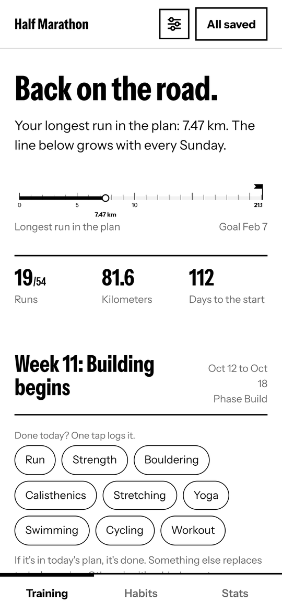
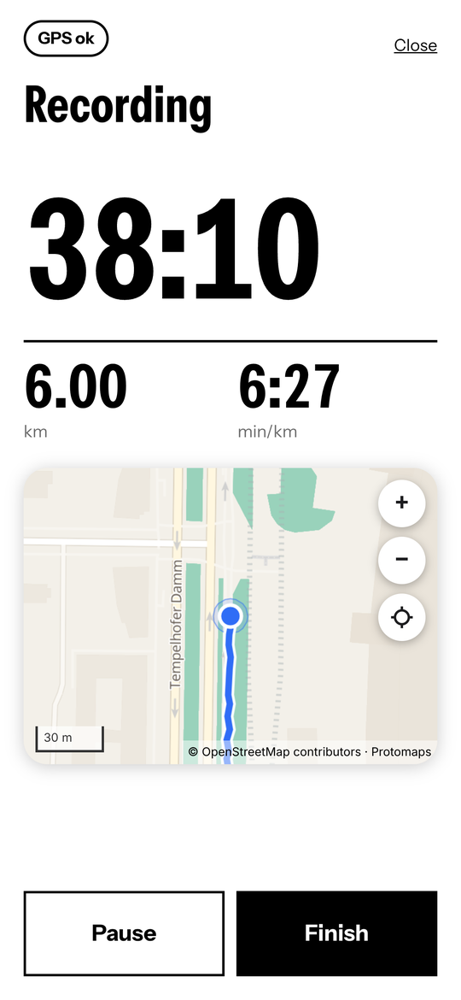
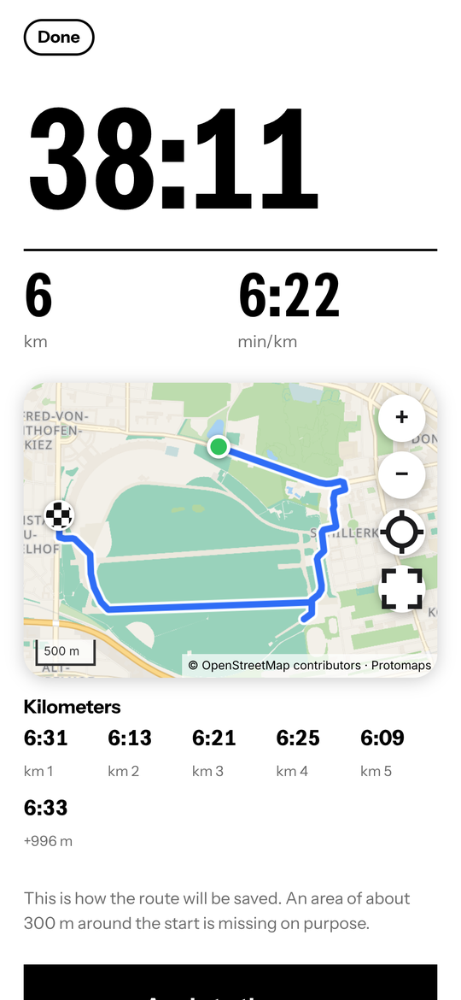
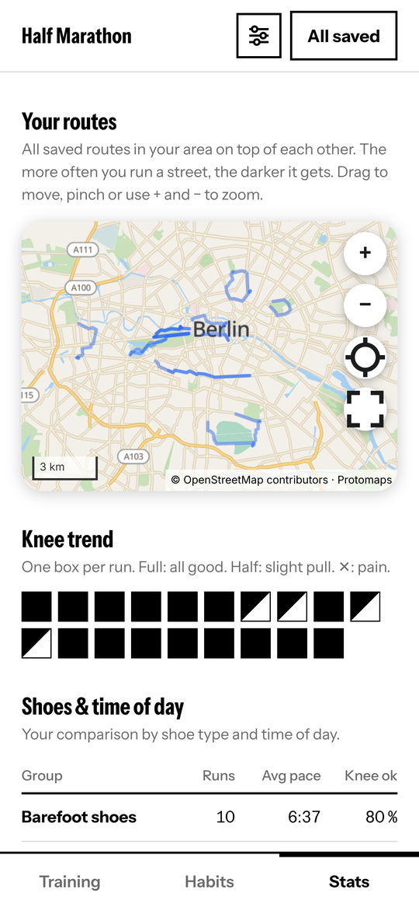
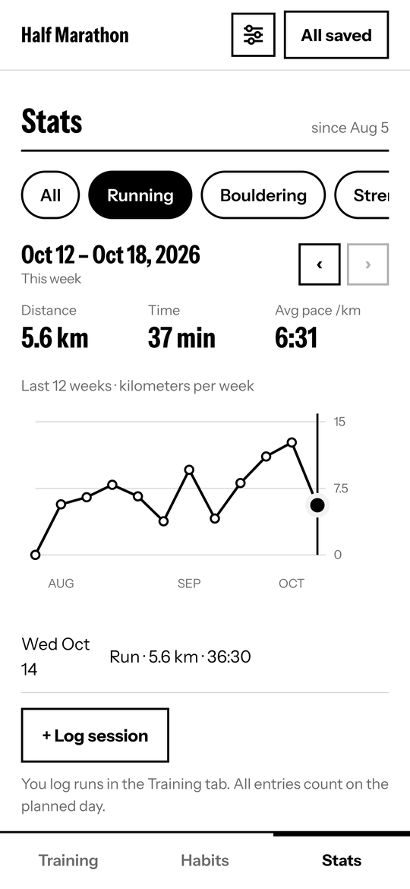
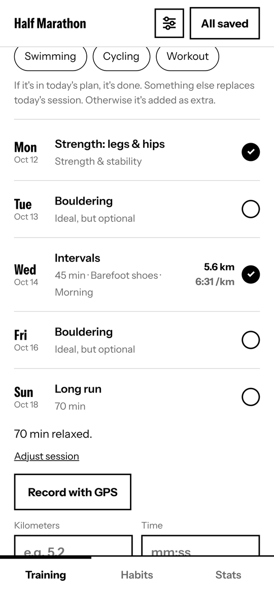
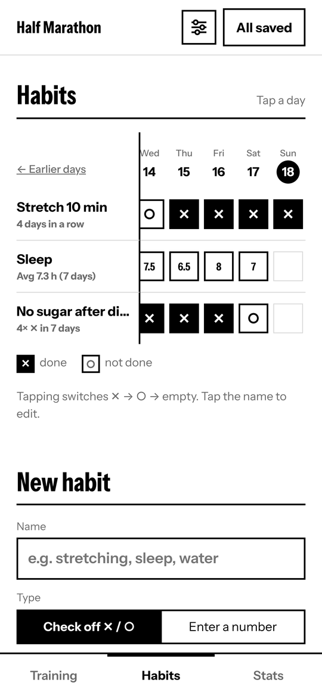
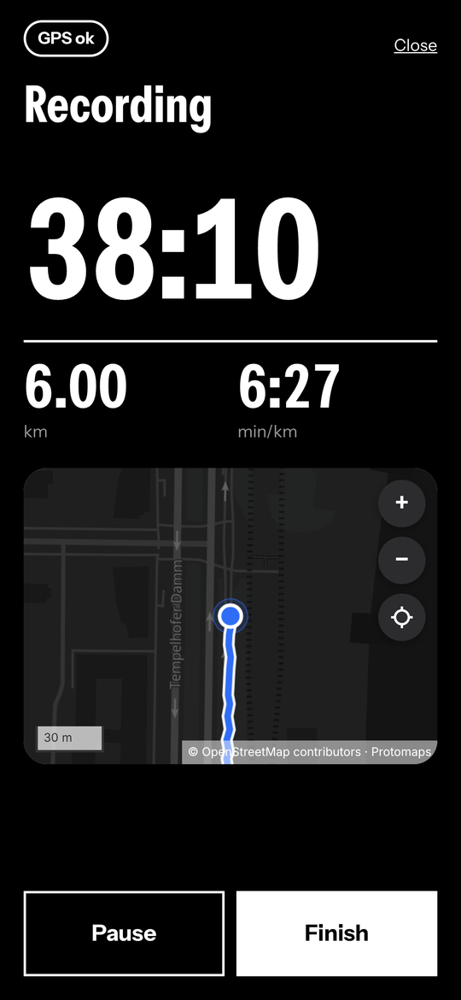
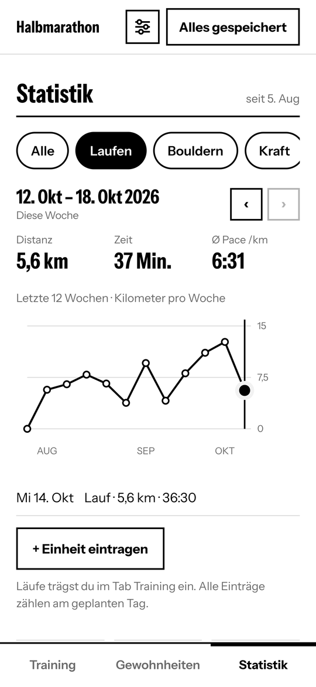

# Half Marathon

[](https://github.com/cyberconical/halbmarathon/releases/latest)
[](LICENSE)
[](#install)
[](#privacy)

**A lean Android app that takes you to a half marathon in 27 weeks.** Training plan, run log with GPS, habits and statistics in one place. It works completely offline and all data stays on your device.

<p align="center">
  
  
  
  
  
</p>
<p align="center"><sub>Screenshots show demo data on the offline Berlin map that ships with the app.</sub></p>

## Highlights

- **A plan that fits your date.** 27 weeks in five phases, from comeback to race week. It aligns itself to your race day and works out your goal pace.
- **GPS recording that survives a locked screen.** Distance, time, pace, every kilometer and the route, with a live map from the first fix.
- **Voice announcements, optional.** Every 500 m or 1 km a voice says distance, recent pace and average pace (English, with your phone's own offline text-to-speech).
- **Offline map.** A Berlin basemap ships inside the app. Nothing is downloaded, nothing reveals where you run.
- **Private by design.** No account, no server, no ads, no trackers, no Google services. A privacy zone around your start is never stored.
- **More than running.** Strength, bouldering, yoga and other sessions, plus your own habits with streaks.
- **Stats that answer questions.** Kilometers per week, pace trend, shoes and time of day compared, learnings and issues you can mark as solved.
- **The backup is the app.** One file holds the app and all your entries.
- **English or German, light or dark.** Black and white, following your phone.

<p align="center">
  
  
  
  
</p>

## Install

The app is not in a store yet. The easiest way is [Obtainium](https://github.com/ImranR98/Obtainium), which detects new versions automatically:

1. Install Obtainium.
2. In Obtainium, tap "Add app" and paste `https://github.com/cyberconical/halbmarathon`.
3. Tap "Add" and then "Install". Android asks once for permission to install apps from this source.

Alternatively, download `halbmarathon.apk` from the [latest release](https://github.com/cyberconical/halbmarathon/releases/latest) and install it by hand.

Requirement: Android 5.1 or newer.

Planned, not available yet: F-Droid, Google Play, iOS.

## Getting started

1. Open the settings at the top right and enter your race day and goal time. Choose your language there too.
2. Log your first run in the **Training** tab, or tap "Record with GPS".
3. Save a backup regularly, see [Backup](#backup).

## Features

**Training**
- A 27-week plan with two runs per week, in five phases from comeback to race week. It aligns itself to your race day.
- Log runs with kilometers, time, feel, shoes and time of day.
- Extra sessions such as strength, bouldering or yoga on three days of your choice.
- Log what you did today with one tap. Every session can be adjusted, and "Back to plan" restores the suggestion.
- Optional GPS recording: distance, time, pace, every kilometer and the route. It only tracks, and the screen may stay off.
- A live map while recording, showing your position, the accuracy circle and the track so far.
- Optional voice announcements every 500 m or 1 km, in English.
- The route appears as a map in the run and, overlaid, in the stats. Drag to move it, pinch, double tap or use + and - to zoom, or open it full screen. GPS noise is smoothed so the line follows your path. The map shows your line on a Berlin basemap bundled in the app; outside Berlin, or without the map file, it is just the line.

**Habits**
- Create your own habits, check them off per day or enter a number.
- Streaks and weekly average at a glance.

**Stats**
- Weekly overview per sport, kilometers per week and pace trend.
- Comparison by shoe type and time of day.
- Record learnings and issues and mark them as solved.

**Settings**
- Language: English or German.
- Race day and goal time, which give the goal pace.
- A body part you want to keep an eye on, for example your knee.
- Records and personal goals per sport.
- GPS and route: privacy zone around the start, whether the route is saved, voice announcements, and a test mode for inaccurate GPS.
- Diagnostics: an anonymous log for when a recording stops.

## Privacy

- All entries live in the app's private storage. There is no server and no account.
- The app calls no servers. It uses no Google services, no ads and no trackers. The font and the map ship with the app.
- Location is used only during a recording and is never sent. The app reads the device's GPS directly, not Google's location services. Raw fixes stay in memory. Only the result is stored, with the route if you want.
- An adjustable **privacy zone** (300 m by default) around the start is never stored. Distance and time still count in full. It protects against the obvious but is no substitute for caution: someone who knows your route can guess the area.
- Under Settings there is a **diagnostic log** that helps find out why a recording stops. It only records technical events, never places, distances, dates, names or a device ID. You can view, share, delete or switch it off. It only leaves the device if you share it.
- Android does not back up the app data to the cloud. Your entries only leave the device if you share a backup yourself.
- Uninstalling the app or clearing its data deletes your entries. Updates through Obtainium keep them.

### Backup

- **Save:** Tap "Save backup" at the top and choose a place in the share menu, for example Drive or Files.
- **Restore:** Tap "Load backup" at the very bottom and choose the file.

The backup file contains all your entries and routes, unencrypted. Don't share it via public links and never upload it to a public repository.

## Documentation

Guides, the architecture and the low-code manifesto are in the [wiki](https://github.com/cyberconical/halbmarathon/wiki). Its pages live in `docs/wiki/` and are published from there.

## Development

The app is one file, `index.html`, without frameworks, plus the bundled font in `fonts` and the map libraries in `map`. It is packaged as an Android app with [Capacitor](https://capacitorjs.com), with its own Java plugin for GPS in the background. GitHub Actions does the build.

To try it in the browser:

```
python3 -m http.server
```

Then open `http://localhost:8000`. The browser stores data separately from the app, so your real data stays untouched. GPS recording works in the browser only while the screen is on, and voice announcements and the diagnostic log exist only in the Android app.

How to customize the app, publish a release and what the data model contains is in [docs/development.md](docs/development.md) and in the wiki.

```
index.html                    the app (English source text, German catalog in the script "i18n")
plugins/run-tracker/          GPS recording and voice announcements for Android (no Google services)
map/                          offline map libraries, styles and fonts (the Berlin basemap is added by the build)
fonts/                        Instrument Sans font with license text
docs/screenshots/             the pictures in this file (demo data)
docs/development.md           customizing, data model, publishing
docs/wiki/                    the wiki pages
.github/workflows/build.yml   build, signing and upload to the release
.github/workflows/wiki.yml    publishes docs/wiki to the GitHub wiki
LICENSE                       GNU General Public License v3
README.md                     this file
```

## License

This project is licensed under the [GNU General Public License, version 3](LICENSE) or, at your option, any later version (GPL-3.0-or-later). You may use, change and share the app. Changes you share must stay open under the same license.

Third-party parts keep their own licenses: [MapLibre GL JS](https://maplibre.org) and PMTiles (BSD-3-Clause), the map style by Protomaps (BSD-3-Clause), the map data (c) [OpenStreetMap contributors](https://www.openstreetmap.org/copyright) (ODbL), and the [Instrument Sans](https://github.com/Instrument/instrument-sans) and Noto Sans fonts (SIL Open Font License 1.1). Details are in `map/README.md` and `fonts/OFL.txt`.
