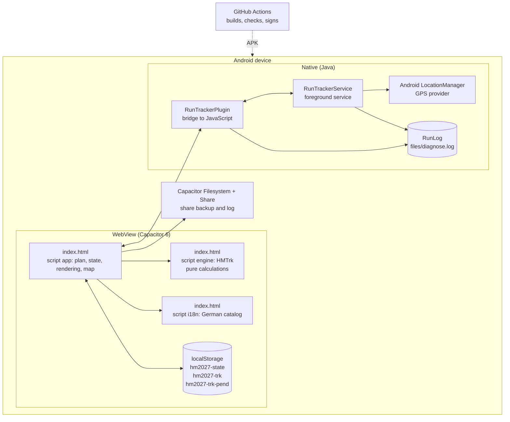
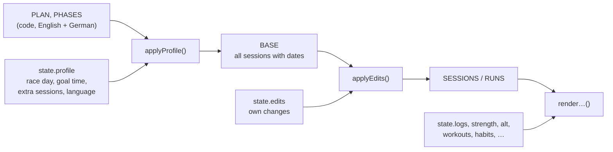
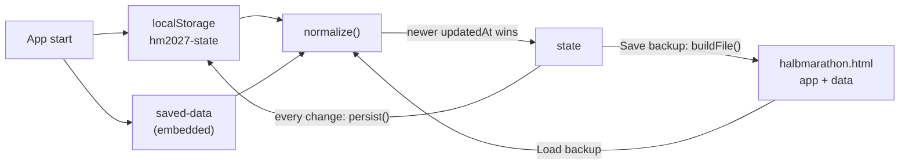
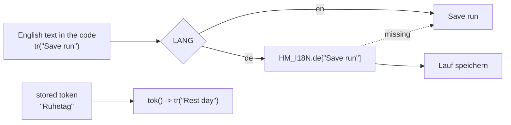
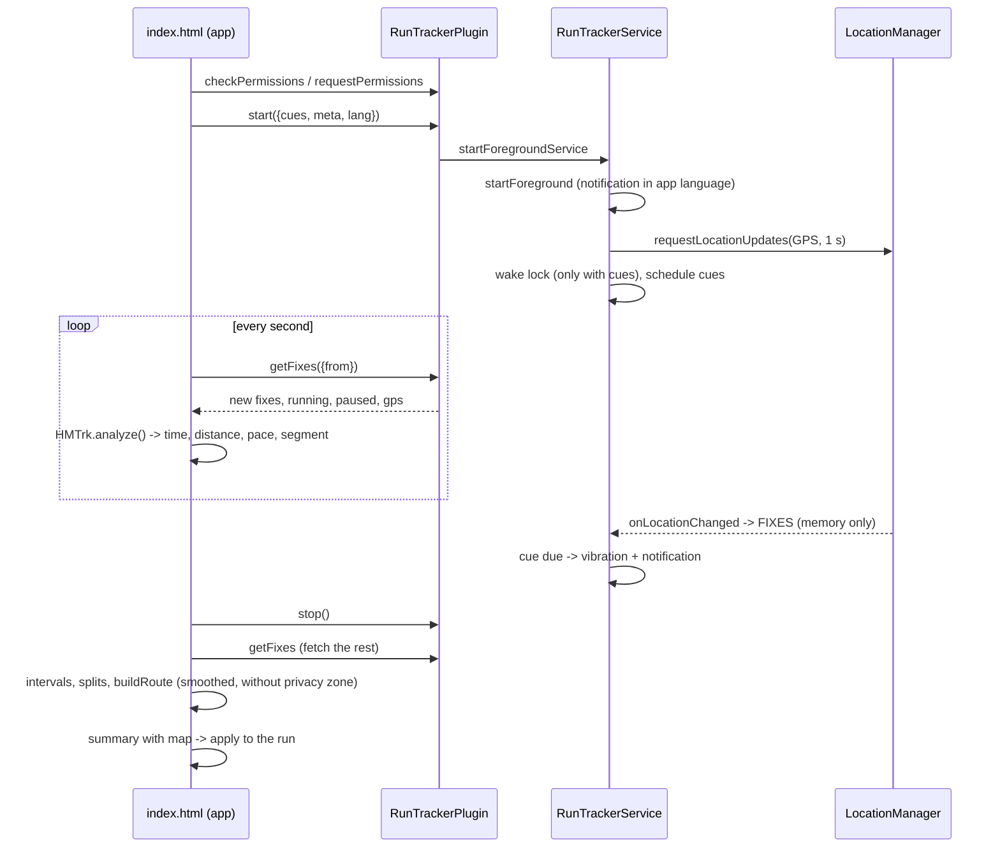
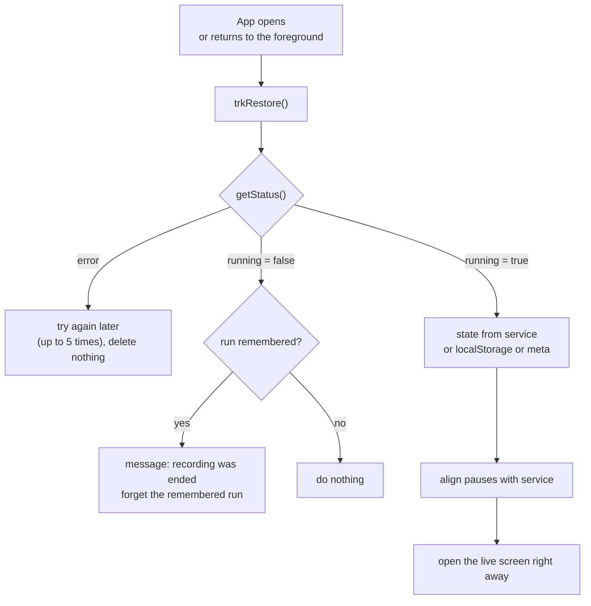
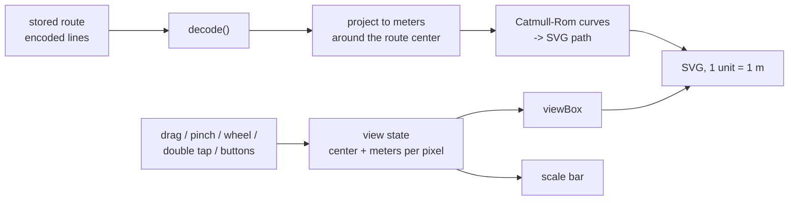

# Architecture

The app has three layers: a single web page (`index.html`), a thin Android shell (Capacitor 6) and its own Java plugin for GPS in the background. The principles behind it are in the [[Low-code manifesto|Low-Code-Manifesto]].

## Overview



There is **no connection to the outside**: no server, no map downloads (the Berlin basemap ships inside the app), no web fonts, no Google services.

## Building blocks

| Block | Where | Job |
|---|---|---|
| UI and logic | `index.html`, script `app` | build the plan, hold the state, render everything, handle events, map, backup |
| Translations | `index.html`, script `i18n` | German catalog keyed by English text. See [[Translations|Translations]] |
| Analysis engine | `index.html`, script `engine` | `HMTrk`: segments, distance, intervals, splits, smoothing, route. See [[Analysis engine|Analysis-Engine]] |
| Embedded data | `index.html`, script `saved-data` | `null` in the original, the data set in a backup file |
| Design | `index.html`, `<style>` | colors as CSS variables, light and dark |
| Font | `fonts/` | Instrument Sans, local, SIL Open Font License |
| GPS plugin | `plugins/run-tracker/` | foreground service, bridge, diagnostic log. See [[Android plugin|Android-Plugin]] |
| Build | `.github/workflows/build.yml` | create, check, build and sign the Android project. See [[Build and release|Build-and-Release]] |
| Wiki | `docs/wiki/`, `.github/workflows/wiki.yml` | these pages, mirrored to the GitHub wiki |

## Structure of `index.html`

```
<style>                              design, CSS variables at the top
<header> <main> <nav>                top bar, three tabs + settings, tab bar (static text with data-t)
<dialog id="sheet">                  input sheets
<div id="runUI"> / <button runBar>   run screen and run bar

<script id="saved-data">null         embedded data (backup)
<script id="i18n">                   window.HM_I18N.de = { "English": "Deutsch", … }
<script id="engine">                 HMTrk, pure functions
<script id="app">
  Language     tr(), bi(), pick(), applyStatic(), date and number formats
  Data         PLAN, PHASES, LINES, tokens (ALTS, DAYCHOICES, TOKENS, SEGNAMES, …)
  Profile      applyProfile() -> START, RACE, BASE; applyEdits() -> SESSIONS, RUNS
  State        normalize(), state, persist(), saveLocal()
  Rendering    renderHero/Week/Plan/Kraft, renderHabits, renderStats/Overview/Learnings, renderSettings
  GPS          trkBegin, trkTick, trkPause/Resume, trkEnd, trkRestore, run screens
  Map          mapHTML, pointer/wheel handlers, mapZoom, mapFit, mapFull
  Diagnostics  hmlog, diagLoad, diagShow, diagShare
  Events       one click handler per area (delegation via data-* attributes)
  Backup       buildFile(), load, delete
  Start        applyProfile(); render(); showTab(); trkRestore()
```

## From plan to screen

The plan is recalculated at every start and on every change of profile or language. It is never stored, only the deviations from it.



- `applyProfile()` calculates the plan start (27 weeks before the Monday of race week), picks the texts in the current language, inserts the goal pace into the descriptions and creates the sessions for every week.
- `applyEdits()` lays the own changes on top: another day, title, description, minutes, type, removed.
- Session IDs are stable (`w3-wed`), independent of the calendar. That is why entries stay with their week when race day changes.

## State and saving



- Every change calls `persist()`: set the timestamp, write to `localStorage`, switch the backup button to “Save backup”.
- `normalize()` is the only door into the state. It turns everything into a valid data set, including data from old versions. See [[Data model|Data-Model]].

## Language



The language lives in `state.profile.lang`. `setLang()` switches it, re-applies the static markup (`data-t`), rebuilds the plan and renders again. Details: [[Translations|Translations]].

## GPS recording



Key points:

- **The service doesn't calculate.** It collects fixes and vibrates at fixed times. All calculation happens in the engine in JavaScript.
- **The UI catches up.** With the screen off the service keeps collecting; the UI later reads all fixes from its last position.
- **The engine computes the cue times and texts** (`cuesFor`) in the current language and hands them to the service at start. The service schedules them on running time; pauses shift them.

## Reattaching after a restart

Android may end the UI in the background at any time. The foreground service keeps running. So that the app can reattach when opened, the UI's small state (session, start time, pauses, laps) exists twice:



The rules behind it:

- If the service runs, the app **always** reattaches, even if the session is no longer in the plan.
- A remembered run is only forgotten when the service is **certainly** no longer running.
- If the whole process ends, the fixes are gone. This is intentional: nothing unfinished ever lies on storage. The app says so clearly.

## The map



- `mapHTML()` returns the markup with the line already drawn. Maps are inserted with `innerHTML` in several places; a `MutationObserver` initializes each new map, and a `ResizeObserver` keeps it correct when it becomes visible, is rotated or goes full screen.
- Moving and zooming only change the visible window (`viewBox`). The path itself is not recalculated. `vector-effect: non-scaling-stroke` keeps the line width constant.
- All map events are delegated on the document (pointer events for drag and pinch, wheel, click for buttons), so they work for any map without wiring.

## Design decisions

| Decision | Reason | Cost |
|---|---|---|
| One file instead of many | fits into an AI chat, no tools needed | big file, merge conflicts more likely |
| No framework | nothing to learn, nothing to update | rendering rebuilds HTML with template strings |
| `localStorage`, one data set | simple, fast, offline | data loss on uninstall without backup |
| Backup is the app itself | backup is readable and usable without the app | backup files must never become public |
| Plan in code, changes as a layer | “Back to plan” always works, goal pace follows | changing the plan means a new release |
| English source, catalog per language | code and docs in one language, languages are data | every new text needs a translation |
| Stored values stay German tokens | old data and backups keep working | a small lookup table for display |
| Intervals from the description text | one text, one truth | unusual sentences are not recognized |
| Own GPS plugin instead of ready-made ones | ready-made plugins depend on Google Play Services | own Java code, not testable in a browser |
| Raw fixes only in memory | nothing unfinished and precise on storage | if the process dies, the run is lost |
| Route smoothed before storing | cleaner line, fewer points, smaller backup | sharp corners get slightly rounded |
| Route as a drawn line, no tiles | no network calls, nothing reveals where you run | no streets or places on the map |

## Limits and possible next steps

- Move the engine into its own file with tests once it grows further.
- Optionally (explicitly chosen) save the running recording encrypted to storage, if phone makers' battery managers often end runs. That would soften a principle and is therefore not built.
- Automated tests in the build, see [[Contributing and testing|Contributing-and-Testing]].
