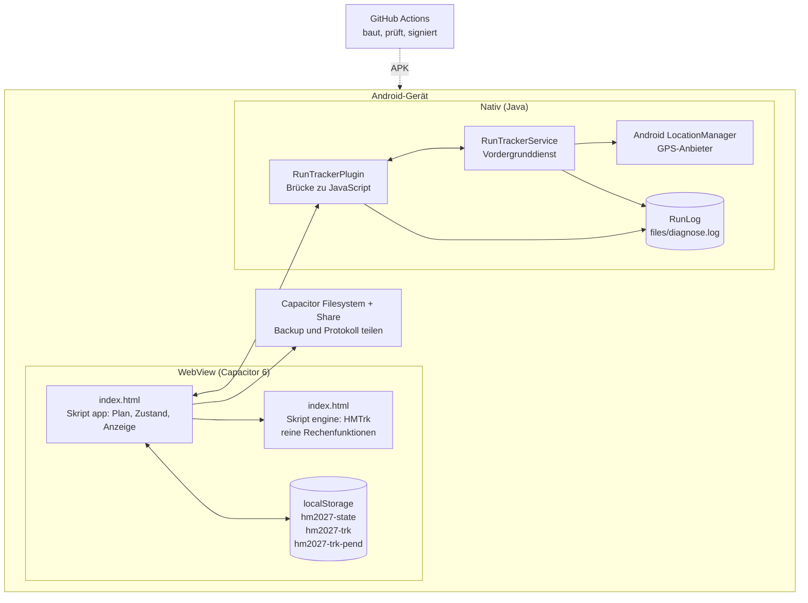
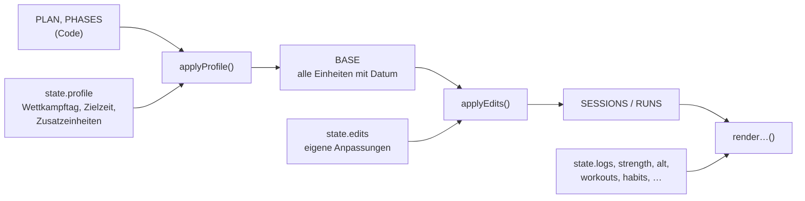
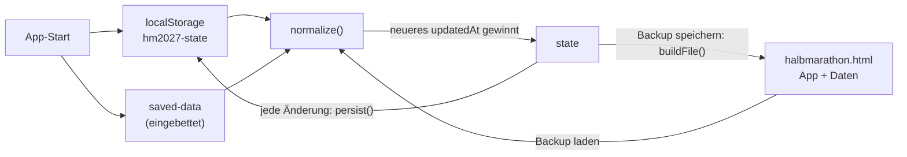
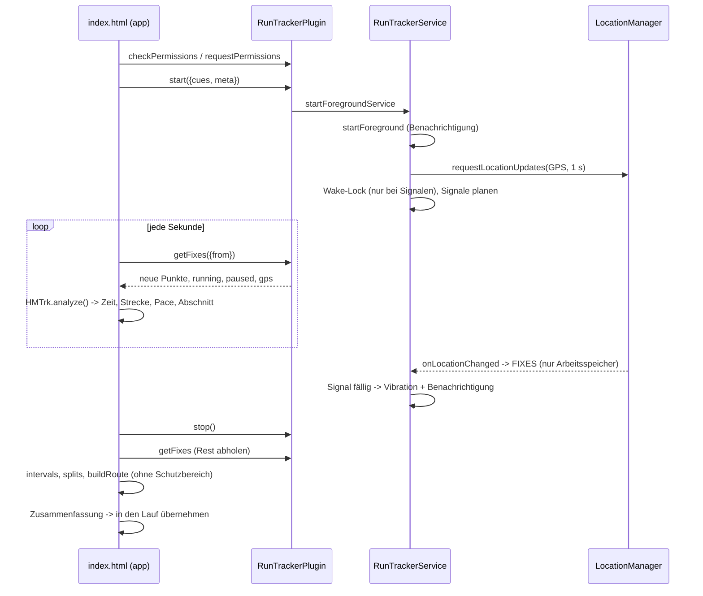
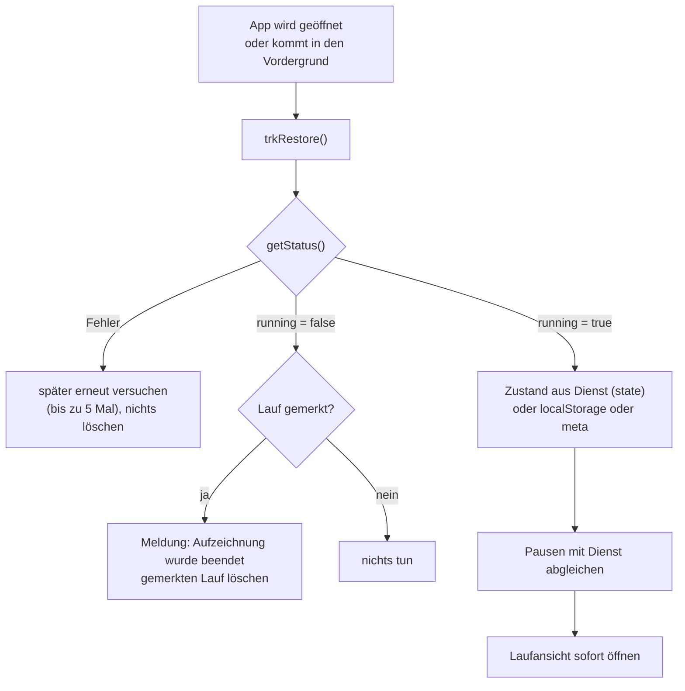

# Architektur

Die App hat drei Schichten: eine einzige Webseite (`index.html`), eine dünne Android-Hülle (Capacitor 6) und ein eigenes Java-Plugin für das GPS im Hintergrund. Die Grundsätze dahinter stehen im [[Low-Code-Manifest|Low-Code-Manifest]].

## Überblick



Es gibt **keine Verbindung nach außen**: keinen Server, keine Kartenkacheln, keine Schrift aus dem Netz, keine Google-Dienste.

## Die Bausteine

| Baustein | Ort | Aufgabe |
|---|---|---|
| Oberfläche und Logik | `index.html`, Skript `app` | Plan aufbauen, Zustand halten, alles anzeigen, Ereignisse verarbeiten, Backup |
| Auswertungs-Engine | `index.html`, Skript `engine` | `HMTrk`: Abschnitte, Strecke, Intervalle, Splits, Route. Siehe [[Auswertungs-Engine|Auswertungs-Engine]] |
| Eingebettete Daten | `index.html`, Skript `saved-data` | im Original `null`, in einer Backup-Datei der Datensatz |
| Design | `index.html`, `<style>` | Farben als CSS-Variablen, hell und dunkel |
| Schrift | `fonts/` | Instrument Sans, lokal, SIL Open Font License |
| GPS-Plugin | `plugins/run-tracker/` | Vordergrunddienst, Bridge, Diagnose-Protokoll. Siehe [[Android-Plugin|Android-Plugin]] |
| Build | `.github/workflows/build.yml` | Android-Projekt erzeugen, prüfen, bauen, signieren. Siehe [[Build-und-Release|Build-und-Release]] |

## Aufbau von `index.html`

```
<style>                              Design, CSS-Variablen ganz oben
<header> <main> <nav>                Kopfleiste, drei Tabs + Einstellungen, Tab-Leiste
<dialog id="sheet">                  Eingabe-Blätter
<div id="runUI"> / <button runBar>   Laufansicht und Lauf-Leiste

<script id="saved-data">null         eingebettete Daten (Backup)
<script id="engine">                 HMTrk, reine Funktionen
<script id="app">
  Daten        PLAN, PHASES, LINES, ALTS, SHOES, TODS, DAYCHOICES
  Profil       applyProfile() -> START, RACE, BASE; applyEdits() -> SESSIONS, RUNS
  Zustand      normalize(), state, persist(), saveLocal()
  Anzeige      renderHero/Week/Plan/Kraft, renderHabits, renderStats/Overview/Learnings, renderSettings
  GPS          trkBegin, trkTick, trkPause/Resume, trkEnd, trkRestore, Laufansicht, routeSVG
  Diagnose     hmlog, diagLoad, diagShow, diagShare
  Ereignisse   ein Klick-Handler pro Bereich (Delegation über data-*-Attribute)
  Backup       buildFile(), Laden, Löschen
  Start        applyProfile(); render(); showTab(); trkRestore()
```

## Vom Plan zur Anzeige

Der Plan wird bei jedem Start und bei jeder Änderung des Profils neu berechnet. Er wird nie gespeichert, nur die Abweichungen davon.



- `applyProfile()` rechnet den Planstart (27 Wochen vor dem Montag der Race Week), setzt die Zielpace in die Beschreibungen ein und legt für jede Woche die Einheiten an.
- `applyEdits()` legt die eigenen Anpassungen darüber: anderer Tag, Titel, Beschreibung, Minuten, Art, entfernt.
- Die IDs der Einheiten sind stabil (`w3-wed`), unabhängig vom Kalender. Deshalb bleiben Einträge ihrer Woche zugeordnet, wenn sich der Wettkampftag ändert.

## Zustand und Speichern



- Jede Änderung ruft `persist()`: Zeitstempel setzen, in `localStorage` schreiben, Backup-Schaltfläche auf „Backup speichern“ stellen.
- `normalize()` ist die einzige Tür in den Zustand. Sie macht aus allem einen gültigen Datensatz, auch aus Daten alter Versionen. Siehe [[Datenmodell|Datenmodell]].

## GPS-Aufzeichnung



Wichtig für das Verständnis:

- **Der Dienst rechnet nicht.** Er sammelt Punkte und vibriert zu festen Zeitpunkten. Alles Rechnen passiert in der Engine in JavaScript.
- **Die Oberfläche holt nach.** Bei ausgeschaltetem Bildschirm sammelt der Dienst weiter, die Oberfläche liest später alle Punkte ab ihrer letzten Position.
- **Die Signalzeitpunkte rechnet die Engine** (`cuesFor`) und gibt sie beim Start an den Dienst. Der Dienst plant sie auf Laufzeit, Pausen verschieben sie.

## Wieder anknüpfen nach einem Neustart

Android darf die Oberfläche im Hintergrund jederzeit beenden. Der Vordergrunddienst läuft dann weiter. Damit die App beim Öffnen anknüpfen kann, liegt der kleine Zustand der Oberfläche (Einheit, Startzeit, Pausen, Runden) doppelt vor:



Die Regeln dahinter:

- Läuft der Dienst, knüpft die App **immer** an, auch wenn die Einheit nicht mehr im Plan steht.
- Ein gemerkter Lauf wird nur gelöscht, wenn der Dienst **sicher** nicht mehr läuft.
- Endet der ganze Prozess, sind die Punkte weg. Das ist gewollt: Es liegt nie etwas Unfertiges auf dem Datenträger. Die App sagt es dann klar.

## Designentscheidungen

| Entscheidung | Grund | Preis |
|---|---|---|
| Eine Datei statt vieler | passt in einen KI-Chat, keine Werkzeuge nötig | große Datei, Merge-Konflikte wahrscheinlicher |
| Kein Framework | nichts zu lernen, nichts zu aktualisieren | Anzeige wird per Template-Strings neu gebaut |
| `localStorage`, ein Datensatz | einfach, schnell, offline | Datenverlust beim Deinstallieren ohne Backup |
| Backup ist die App selbst | Backup ist lesbar und ohne App nutzbar | Backup-Dateien dürfen nie öffentlich werden |
| Plan im Code, Anpassungen als Schicht | „Zurück zum Plan“ geht immer, Zielpace wandert mit | Plan ändern heißt neues Release |
| Intervalle aus dem Beschreibungstext | ein Text, eine Wahrheit | ungewöhnliche Sätze werden nicht erkannt |
| Eigenes GPS-Plugin statt fertiger Plugins | fertige Plugins hängen an Google Play Services | eigener Java-Code, im Browser nicht testbar |
| Rohe Punkte nur im Arbeitsspeicher | nichts Unfertiges und Genaues auf dem Datenträger | stirbt der Prozess, ist der Lauf weg |
| Route als gezeichnete Linie | keine Kartenkacheln, keine Netzwerkaufrufe | keine Straßen oder Orte auf der Karte |

## Grenzen und mögliche nächste Schritte

- Die Engine in eine eigene Datei mit Tests auslagern, sobald sie weiter wächst.
- Optional (ausdrücklich gewählt) die laufende Aufzeichnung verschlüsselt auf dem Datenträger sichern, falls Hersteller-Akkumanager Läufe oft beenden. Das würde einen Grundsatz aufweichen und ist deshalb nicht gebaut.
- Automatische Tests im Build, siehe [[Mitwirken-und-Testen|Mitwirken-und-Testen]].
