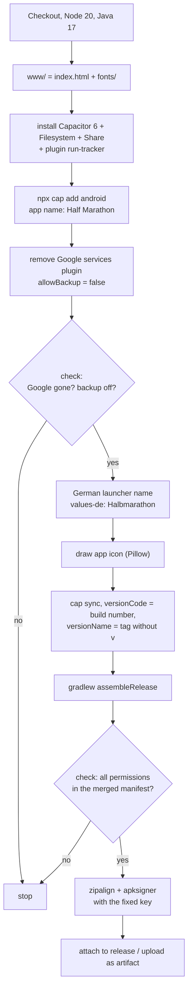

# Build and release

The app is built on GitHub. The repository contains no Android project; the build creates it from scratch on every run from `index.html`, `fonts/` and `plugins/run-tracker/`.

## When it builds

The workflow `.github/workflows/build.yml` (“Build APK”) runs

- on every **published release**. The APK is attached to the release.
- **manually** via the “Actions” tab, “Build APK”, “Run workflow” (choose a branch). The APK is then available as the artifact `halbmarathon-apk` of that run.
- on every push to the branch `claude/gps-tracking` (for testing).

A run takes about 2 minutes.

## What the build does

### The checks

The build stops if

- `google-services` still appears in the Android project,
- `android:allowBackup="false"` is not set,
- one of these permissions is missing from the merged manifest: `ACCESS_FINE_LOCATION`, `FOREGROUND_SERVICE`, `FOREGROUND_SERVICE_LOCATION`, `WAKE_LOCK`, `POST_NOTIFICATIONS`, `VIBRATE`,
- the service is not registered as `foregroundServiceType="location"`,
- the signature can't be verified.

The permission check was added after the crash in v1.6.0, see [[Low-code manifesto|Low-Code-Manifesto]], “Two cases from practice”.

## Publishing a new version

1. Merge the changes into `main`.
2. Under “Releases”, choose “Draft a new release”.
3. Create a new tag such as `v1.7.0`, target `main`.
4. Enter a title and a short description for users.
5. “Publish release”. After about 2 minutes `halbmarathon.apk` is attached to the release. Obtainium detects the update.

### Version numbers

| Part | Value |
|---|---|
| `versionName` | the tag without `v`, for example `1.7.0`. For manual runs `0.0.0`. |
| `versionCode` | the workflow's running build number |

Android only installs an update if `versionCode` is higher. Because the build number always rises, this works automatically. Note that an APK from a manual run also has a higher number than an older release.

## Signing

The APK is signed with a fixed key. It is not in the code but stored as repository secrets on GitHub: `KEYSTORE_BASE64` and `KEYSTORE_PASSWORD` (Settings, Secrets and variables, Actions).

- All updates must be signed with the same key. An installed app can't be updated with a different one. It would have to be uninstalled first, which deletes the entries.
- Keep the key and password outside GitHub as well. If they are lost, existing installations get no more updates.
- A key or password must never be in the repository, not even in older versions of files.

## Technology at a glance

| Part | Implementation |
|---|---|
| App | `index.html`, HTML, CSS and JavaScript without frameworks |
| Android shell | Capacitor 6, app ID `de.halbmarathon.app` |
| Capacitor plugins | `@capacitor/filesystem`, `@capacitor/share`, own `run-tracker` |
| Build | GitHub Actions, Node 20, Java 17, Gradle |
| Minimum version | Android 5.1 (API 22) |
| License | GPL-3.0-or-later |

## Wiki

This wiki lives in the repository under `docs/wiki/`. The workflow `wiki.yml` (“Publish wiki”) checks the internal links and publishes the pages to the GitHub wiki on every push to `main` that changes them, and can also be started manually. The wiki must exist once: create the first page in the “Wiki” tab (any content). See [[Contributing and testing|Contributing-and-Testing]].
