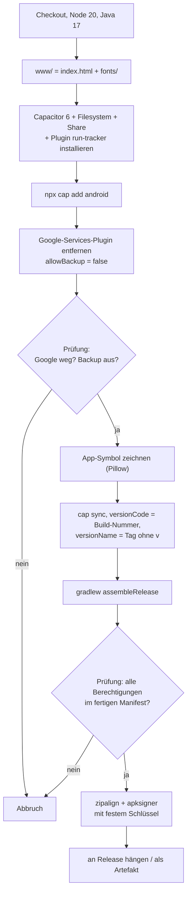

# Build und Release

Die App wird bei GitHub gebaut. Im Repository liegt kein Android-Projekt. Der Build erzeugt es bei jedem Lauf neu aus `index.html`, `fonts/` und `plugins/run-tracker/`.

## Wann gebaut wird

Der Workflow `.github/workflows/build.yml` („APK bauen“) läuft

- bei jedem **veröffentlichten Release**. Die APK wird an das Release angehängt.
- **manuell** über den Reiter „Actions“, „APK bauen“, „Run workflow“. Die APK steht danach als Artefakt `halbmarathon-apk` im Lauf.
- bei jedem Push auf den Branch `claude/gps-tracking` (zum Testen).

Ein Lauf dauert etwa 2 Minuten.

## Was der Build tut

### Die Prüfungen

Der Build bricht ab, wenn

- im Android-Projekt noch `google-services` vorkommt,
- `android:allowBackup="false"` nicht gesetzt ist,
- im zusammengeführten Manifest eine dieser Berechtigungen fehlt: `ACCESS_FINE_LOCATION`, `FOREGROUND_SERVICE`, `FOREGROUND_SERVICE_LOCATION`, `WAKE_LOCK`, `POST_NOTIFICATIONS`, `VIBRATE`,
- der Dienst nicht als `foregroundServiceType="location"` eingetragen ist,
- die Signatur nicht verifiziert werden kann.

Die Berechtigungsprüfung kam nach dem Absturz in v1.6.0 dazu, siehe [[Low-Code-Manifest|Low-Code-Manifest]], „Ein Fall aus der Praxis“.

## Neue Version veröffentlichen

1. Änderungen in `main` mergen.
2. Unter „Releases“ auf „Draft a new release“ gehen.
3. Einen neuen Tag wie `v1.6.1` anlegen, Ziel `main`.
4. Titel und eine kurze Beschreibung für Nutzer eintragen.
5. „Publish release“. Nach etwa 2 Minuten hängt `halbmarathon.apk` am Release. Obtainium erkennt das Update.

### Versionsnummern

| Teil | Wert |
|---|---|
| `versionName` | der Tag ohne `v`, zum Beispiel `1.6.1`. Bei manuellen Läufen `0.0.0`. |
| `versionCode` | die laufende Build-Nummer des Workflows |

Android installiert ein Update nur, wenn `versionCode` größer ist. Weil die Build-Nummer immer steigt, passt das automatisch. Eine APK aus einem manuellen Lauf hat aber ebenfalls eine höhere Nummer als ein älteres Release.

## Signatur

Die APK wird mit einem festen Schlüssel signiert. Er steht nicht im Code, sondern als Repository-Secret bei GitHub: `KEYSTORE_BASE64` und `KEYSTORE_PASSWORD` (Settings, Secrets and variables, Actions).

- Alle Updates müssen mit demselben Schlüssel signiert sein. Mit einem anderen lässt sich eine installierte App nicht aktualisieren. Sie müsste erst deinstalliert werden, dabei gehen die Einträge verloren.
- Bewahre Schlüssel und Passwort zusätzlich außerhalb von GitHub auf. Gehen sie verloren, gibt es keine Updates mehr für bestehende Installationen.
- Ein Schlüssel oder Passwort darf nie im Repository stehen, auch nicht in älteren Versionen von Dateien.

## Technik im Überblick

| Teil | Umsetzung |
|---|---|
| App | `index.html`, HTML, CSS und JavaScript ohne Frameworks |
| Android-Hülle | Capacitor 6, App-ID `de.halbmarathon.app` |
| Capacitor-Plugins | `@capacitor/filesystem`, `@capacitor/share`, eigenes `run-tracker` |
| Build | GitHub Actions, Node 20, Java 17, Gradle |
| Mindestversion | Android 5.1 (API 22) |
| Lizenz | GPL-3.0-or-later |

## Wiki

Dieses Wiki liegt im Repository unter `docs/wiki/`. Der Workflow `wiki.yml` veröffentlicht es bei jedem Push auf `main`, der diese Dateien ändert, ins GitHub-Wiki. Siehe [[Mitwirken-und-Testen|Mitwirken-und-Testen]].
