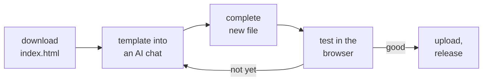

# Customizing with AI

The app is built so it can be changed with an AI assistant such as Claude, ChatGPT or Gemini, even without programming skills and even on a phone. Why this works: [[Low-code manifesto|Low-Code-Manifesto]].

## The flow



## 1. Download

- **Just the app:** in this repository, tap `index.html` and choose “Download raw file” at the top right. Without the `fonts` folder next to it, the app uses the system font.
- **The whole project:** “Code”, then “Download ZIP”. With Git: `git clone https://github.com/cyberconical/halbmarathon.git`

## 2. Describe the change

Upload `index.html` to an AI chat. At about 170 KB it fits into current models. **One change per request**, and always ask for the complete new file.

```
You get the file index.html of my training app. It is a single HTML file
(HTML, CSS, JavaScript, no frameworks) and runs as an Android app via Capacitor.

Change the following: <your wish>

Rules:
- Return the complete, changed index.html, not just snippets.
- Saved data must stay compatible. The storage key "hm2027-state" and the
  existing fields (logs, strength, alt, habits, habitLog, learnings, profile,
  records, goals, workouts, dur, edits, gps, updatedAt) must not be renamed or
  removed. Stored values such as "Kraft", "Ruhetag" or "gut" are tokens and stay
  unchanged. New fields are optional and get a default in normalize().
- The script IDs "saved-data", "i18n", "engine" and "app" and the backup function
  stay. The script "saved-data" stays empty (null) in the original.
- Pure calculations belong in the script "engine" (HMTrk), display and storage in "app".
- All user-facing text is English inside tr("…"). Add the German translation of
  every new text to the catalog in the script "i18n". Plan texts use bi("English", "Deutsch").
- Design: black and white, minimal, use the existing CSS variables. Easy to use
  with a thumb on a phone.
- No external libraries, no network calls and no Google services (no Play
  Services, no Firebase). The font lives locally in the fonts folder.
- No places, dates or names in diagnostic logs (hmlog).
- At the end, tell me in two sentences what you changed and how I test it.
```

## 3. Orientation for humans and AI

| Part of `index.html` | Content |
|---|---|
| `<style>` | design, colors as CSS variables at the top |
| HTML | top bar, three tabs (Training, Habits, Stats) and settings; static text with `data-t` |
| Script `i18n` | German catalog, English text → German text |
| Script `engine` | `HMTrk`: segments from plan text, filters, distance, intervals, splits, smoothing, privacy zone, simplification, encoding |
| Script `app`, top | language (`tr`, `bi`), dates, plan (`PLAN`, `PHASES`), `applyProfile`, `applyEdits` |
| Script `app`, middle | state (`state`, `normalize`, `persist`), rendering (`renderHero`, `renderWeek`, `renderPlan`, `renderHabits`, `renderStats`, `renderOverview`, `renderLearnings`) |
| Script `app`, GPS part | `trkBegin`, `trkTick`, `trkEnd`, `trkRestore`, run screen `#runUI`, map `mapHTML` |
| Script `app`, bottom | events, backup, quick logging, settings (`renderSettings`, `setLang`) |

More: [[Architecture|Architecture]], [[Data model|Data-Model]] and [[Translations|Translations]].

## Recipes

A few wishes and how to phrase them:

| Wish | Phrasing |
|---|---|
| New choice when logging a run | “When logging a run, add a choice ‘Weather’ (sunny, cloudy, rain, wind). Store it optionally as the field `weather` in the run and show the pace per weather in the stats like the comparison by shoes. Add German translations.” |
| New chart | “Show a bar chart of runs per weekday in the stats, in the style of the existing SVG charts.” |
| New extra session | “Add ‘Pilates’ to the selectable extra sessions. Store it as the token ‘Pilates’ and add it to TOKENS.” |
| Change a plan week | see [[Customizing the plan|Customizing-the-Plan]] |
| New tab | “Add a fourth tab ‘Nutrition’ where I can save a note per day. New optional field `food` in the state.” |
| New language | see [[Translations|Translations]], “Adding a language” |

## 4. Test before you publish

1. Open the changed file in a browser: on a PC by double-clicking, on a phone via the Files app in Chrome.
2. Click through all three tabs and the settings, **in English and German**. Log a run, a habit and a learning. The browser stores data separately from the app, so your real data is not affected.
3. If a data field changed: save a backup in the app first and check after the update that everything is there.
4. If something about GPS recording changed: test in the app. The browser has no background service.

## 5. Publish

Upload the new `index.html` to the repository (“Add file”, “Upload files”; the same file name replaces the old one). Then create a release, see [[Build and release|Build-and-Release]].

> **Important:** Never upload a file that came from “Save backup”. It contains your personal entries and would make them public. Before uploading, check that the line `<script id="saved-data" type="application/json">null</script>` ends with `null`.

## With coding agents

With Claude Code, Codex, Cursor or similar tools:

1. Clone the repository and start the agent in the project folder.
2. Put the rules from the template above into a `CLAUDE.md` or `AGENTS.md` file so the agent knows them for every task.
3. Describe the wish. Test locally, for example with `python3 -m http.server` and `http://localhost:8000`.
4. Commit on a branch, open a pull request and start the build on that branch. The build also checks what a browser test can't see.
5. Merge and create a release.

## Checklist before uploading

- [ ] One change, not ten
- [ ] `saved-data` ends with `null`
- [ ] All tabs open without errors, in both languages
- [ ] Every new text has a German translation
- [ ] An old data set (backup) still loads
- [ ] No new `http` addresses in the file
- [ ] Design black and white
