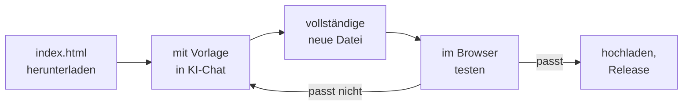

# Mit KI anpassen

Die App ist so gebaut, dass man sie mit einem KI-Assistenten wie Claude, ChatGPT oder Gemini ändern kann, auch ohne Programmierkenntnisse und auch am Handy. Warum das funktioniert: [[Low-Code-Manifest|Low-Code-Manifest]].

## Der Ablauf



## 1. Herunterladen

- **Nur die App:** In diesem Repository auf `index.html` tippen und oben rechts „Download raw file“. Ohne den Ordner `fonts` daneben nutzt die App die Systemschrift.
- **Das ganze Projekt:** „Code“, dann „Download ZIP“. Mit Git: `git clone https://github.com/cyberconical/halbmarathon.git`

## 2. Änderung beschreiben

Die Datei `index.html` in einen KI-Chat hochladen. Mit rund 145 KB passt sie in aktuelle Modelle. **Eine Änderung pro Anfrage** und immer die vollständige neue Datei zurückverlangen.

```
Du bekommst die Datei index.html meiner Trainings-App. Sie ist eine einzelne
HTML-Datei (HTML, CSS, JavaScript, keine Frameworks) und läuft als Android-App
über Capacitor.

Ändere Folgendes: <dein Wunsch>

Regeln:
- Gib die vollständige, geänderte index.html zurück, nicht nur Ausschnitte.
- Gespeicherte Daten müssen kompatibel bleiben. Der Speicherschlüssel
  "hm2027-state" und die vorhandenen Felder (logs, strength, alt, habits,
  habitLog, learnings, profile, records, goals, workouts, dur, edits, gps,
  updatedAt) dürfen nicht umbenannt oder entfernt werden. Neue Felder sind
  optional und bekommen in normalize() einen Standardwert.
- Die Skript-IDs "saved-data", "engine" und "app" und die Backup-Funktion
  bleiben erhalten. Das Skript "saved-data" bleibt im Original leer (null).
- Reine Rechenfunktionen gehören in das Skript "engine" (HMTrk), Anzeige und
  Speichern in "app".
- Design: schwarz-weiß, minimal, bestehende CSS-Variablen nutzen. Gut
  bedienbar mit dem Daumen auf einem Handy.
- Keine externen Bibliotheken, keine Netzwerkaufrufe und keine
  Google-Dienste (kein Play Services, kein Firebase). Die Schrift liegt
  lokal im Ordner fonts.
- Keine Orte, Datumsangaben oder Namen in Diagnose-Protokollen (hmlog).
- Texte auf Deutsch.
- Sag mir am Ende in zwei Sätzen, was du geändert hast und wie ich es teste.
```

## 3. Orientierung für Mensch und KI

| Bereich in `index.html` | Inhalt |
|---|---|
| `<style>` | Design, Farben als CSS-Variablen ganz oben |
| HTML | Kopfleiste, drei Tabs (Training, Gewohnheiten, Statistik) und die Einstellungen |
| Skript `engine` | `HMTrk`: Abschnitte aus dem Plantext, Filter, Strecke, Intervalle, Splits, Schutzbereich, Linienvereinfachung, Kodierung |
| Skript `app`, oben | Plan (`PLAN`, `PHASES`), `applyProfile`, `applyEdits` |
| Skript `app`, Mitte | Zustand (`state`, `normalize`, `persist`), Anzeige (`renderHero`, `renderWeek`, `renderPlan`, `renderHabits`, `renderStats`, `renderOverview`, `renderLearnings`, `renderSettings`) |
| Skript `app`, GPS-Teil | `trkBegin`, `trkTick`, `trkEnd`, `trkRestore`, Laufansicht `#runUI`, Karte `routeSVG` |
| Skript `app`, unten | Klick-Ereignisse, Backup, Schnellerfassung, Einstellungen |

Mehr: [[Architektur|Architektur]] und [[Datenmodell|Datenmodell]].

## Rezepte

Ein paar Wünsche, wie man sie formulieren kann:

| Wunsch | Formulierung |
|---|---|
| Neue Auswahl beim Lauf | „Füge beim Eintragen eines Laufs eine Auswahl ‚Wetter‘ hinzu (sonnig, bewölkt, Regen, Wind). Speichere sie optional als Feld `weather` im Lauf und zeige in der Statistik die Pace je Wetter wie beim Vergleich nach Schuhen.“ |
| Neues Diagramm | „Zeige in der Statistik ein Balkendiagramm der Läufe pro Wochentag. Im Stil der vorhandenen SVG-Diagramme.“ |
| Neue Zusatzeinheit | „Füge ‚Pilates‘ zu den wählbaren Zusatzeinheiten hinzu.“ |
| Andere Plan-Woche | siehe [[Plan-anpassen|Plan-anpassen]] |
| Neuer Tab | „Füge einen vierten Tab ‚Ernährung‘ hinzu, in dem ich pro Tag eine Notiz speichern kann. Neues optionales Feld `food` im Zustand.“ |

## 4. Testen, bevor du veröffentlichst

1. Die geänderte Datei im Browser öffnen, am PC per Doppelklick, am Handy über die Dateien-App in Chrome.
2. Alle drei Tabs und die Einstellungen durchklicken. Einen Lauf, eine Gewohnheit und ein Learning eintragen. Der Browser speichert getrennt von der App, deine echten Daten sind nicht betroffen.
3. Wurde ein Datenfeld geändert: vorher in der App ein Backup speichern und nach dem Update prüfen, ob alles da ist.
4. Wurde etwas an der GPS-Aufzeichnung geändert: in der App testen. Der Browser hat keinen Hintergrunddienst.

## 5. Veröffentlichen

Die neue `index.html` im Repository hochladen („Add file“, „Upload files“, gleicher Dateiname ersetzt die alte). Danach ein Release anlegen, siehe [[Build-und-Release|Build-und-Release]].

> **Wichtig:** Lade niemals eine Datei hoch, die aus „Backup speichern“ stammt. Sie enthält deine persönlichen Einträge und würde sie öffentlich machen. Prüfe vor dem Hochladen, dass in der Datei die Zeile `<script id="saved-data" type="application/json">null</script>` mit `null` endet.

## Mit Coding-Agenten

Mit Claude Code, Codex, Cursor oder ähnlichen Werkzeugen:

1. Repository klonen und im Projektordner den Agenten starten.
2. Die Regeln aus der Vorlage oben in eine Datei `CLAUDE.md` oder `AGENTS.md` legen, damit der Agent sie bei jeder Aufgabe kennt.
3. Den Wunsch beschreiben. Lokal testen, zum Beispiel mit `python3 -m http.server` und `http://localhost:8000`.
4. Auf einem eigenen Branch committen, einen Pull Request öffnen und den Build abwarten. Der Build prüft auch das, was ein Browser-Test nicht sieht.
5. Mergen und ein Release anlegen.

## Checkliste vor dem Hochladen

- [ ] Eine Änderung, nicht zehn
- [ ] `saved-data` endet mit `null`
- [ ] Alle Tabs öffnen ohne Fehler
- [ ] Ein alter Datensatz (Backup) lädt noch
- [ ] Keine neuen `http`-Adressen in der Datei
- [ ] Texte auf Deutsch, Design schwarz-weiß
