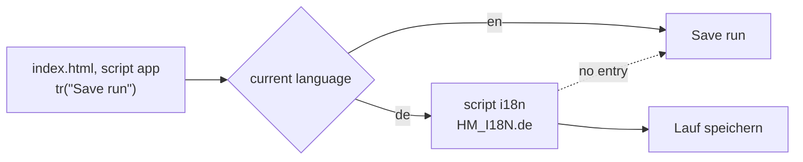

# Translations

The app is written in **English**. German is a translation you can choose under Settings, Language. This page explains how that works and how to add or fix a translation.

## How it works



There are four mechanisms, each for one kind of text:

| Kind of text | Mechanism | Example |
|---|---|---|
| Text in the code | `tr("English text")`, translated through the catalog | `tr("Save run")` |
| Text with values | placeholders in braces | `tr("{n} days in a row", {n})` |
| Static markup in the HTML | attributes `data-t` (text), `data-t-ph` (placeholder), `data-t-aria` (screen reader label); the English text in the markup is the key | `<h2 data-t>Habits</h2>` |
| Plan texts (weeks, phases, descriptions, praise) | bilingual data, `bi("English", "Deutsch")` | `R(EASY, 25, bi("25 min easy …", "25 Min. locker …"))` |

Plus two things that are not text but format:

- **Dates:** month and weekday names per language, `Oct 4` / `4. Okt`, `Wednesday, October 7` / `Mittwoch, 7. Oktober`.
- **Numbers:** decimal point or comma, `5.2 km` / `5,2 km`. Input accepts both in either language.

## The catalog

The catalog is the script `i18n` in `index.html`:

```js
window.HM_I18N = { de: {
  "Save run": "Lauf speichern",
  "{n} days in a row": "{n} Tage in Folge",
  …
} };
```

- Keys are the exact English texts, sorted alphabetically.
- A **missing key shows the English text**. Nothing breaks, the screen is just partly English.
- Placeholders such as `{n}` must appear in the translation too; their order may change.
- The same English text always has the same translation. If one English word needs two different German words in two places, use two different English texts (for example “Done” for a finished run and “Completed” for a checked goal).

The catalog currently has 524 entries.

## Stored values are not translated

Some values are stored as German tokens from earlier versions (“Kraft”, “Ruhetag”, “gut”, …). They stay unchanged in storage so old data and backups keep working, and are translated only for display. See [[Data model|Data-Model]], “Stored tokens”.

## Plan text and GPS

The GPS engine reads interval structure from the description of a session, in English or in German. Both versions of every plan session are written so they produce identical segments, and a test checks this. When you change a description, keep the patterns from [[Customizing the plan|Customizing-the-Plan]]. Segment names are language-neutral keys and are translated for display.

## What follows the language setting

- all texts of the app, including the plan
- date and number formats
- the notification of the GPS service (the app passes its language when a recording starts)
- the texts of vibration cues in the notification

What does **not** follow it:

- your own entries (notes, habit names, custom activities, adjusted titles) stay as typed
- the app's name on the home screen follows the phone's language (“Half Marathon”, on German phones “Halbmarathon”)
- the diagnostic log's event words, which are fixed technical codes

## Fixing a translation

1. Find the English text in the catalog (script `i18n`).
2. Change the German value. Keep placeholders.
3. Test in the browser with German selected.

## Adding a new text

1. Write it in English inside `tr("…")` in the code, or with `data-t` in the markup.
2. Add the German translation to the catalog, in alphabetical position.
3. Run the completeness check below.

## Adding a language

1. In the script `i18n`, copy the `de` block, name it with the new language code (for example `fr`) and translate all values.
2. In the script `app`, add the language to `LANGS`, for example `["fr","Français"]`.
3. Add month and weekday names to `NAMES` and decide on the decimal separator in `DEC` and the date order in `fmtDate`, `fmtDayLong`, `fmtFull` and `fmtLongDate`.
4. Give every plan text a third version: `bi()` takes English and German today; extend it to an object such as `{en, de, fr}` (`pick()` already reads any language code and falls back to English).
5. If plan descriptions in the new language should drive GPS intervals, add its words to `KEYWORDS` and the patterns in the engine. Otherwise keep the descriptions in the patterns' format.
6. For the notification, extend `txt()` in `RunTrackerService.java`.

## Checking completeness

This check lists every `tr("…")` key without a German translation and every placeholder mismatch. Run it in the repository folder with Node:

```js
const fs = require("fs"), vm = require("vm");
const html = fs.readFileSync("index.html", "utf8");
const c = { window: {} };
vm.runInNewContext(html.match(/<script id="i18n">([\s\S]*?)<\/script>/)[1], c);
const de = c.window.HM_I18N.de;
const app = html.match(/<script id="app">([\s\S]*?)<\/script>/)[1];
const keys = new Set([...app.matchAll(/\btr\("((?:[^"\\]|\\.)*)"/g)].map(m => JSON.parse('"' + m[1] + '"')));
for (const m of html.matchAll(/data-t(?:-ph|-aria)?="([^"]+)"/g)) keys.add(m[1]);
const ph = s => (s.match(/\{\w+\}/g) || []).sort().join();
for (const k of keys) {
  if (!(k in de)) console.log("missing:", k);
  else if (ph(k) !== ph(de[k])) console.log("placeholders differ:", k);
}
```

Texts in lists (for example the names of record templates or exercises) are passed to `tr()` as variables and are not found by this static check. Check them by clicking through the app in German. The full check used during development also records every key the app asks for at runtime; see [[Contributing and testing|Contributing-and-Testing]].
